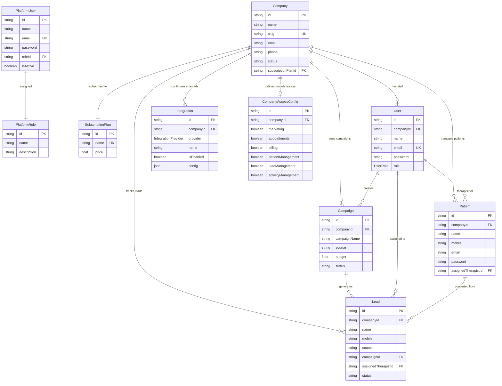

# Sales Guru CRM - APIs & Services Walkthrough

Welcome to the technical overview of the **Sales Guru CRM** platform (also known as *PhysioYoga CRM*). This documentation details the project's architecture, services, database models, Next.js Server Actions, and all REST API endpoints with request/response examples.

---

## Table of Contents

1. [Architecture & Technology Stack](#1-architecture--technology-stack)
2. [Database Schema & Models](#2-database-schema--models)
3. [Authentication & Session Flow](#3-authentication--session-flow)
4. [REST API Endpoints Reference](#4-rest-api-endpoints-reference)
   - [Super Admin APIs](#super-admin-apis)
   - [Company Admin & Staff APIs](#company-admin--staff-apis)
   - [Patient APIs](#patient-apis)
   - [Meta Ads Integration APIs](#meta-ads-integration-apis)
   - [Public & Utility APIs](#public--utility-apis)
5. [Next.js Server Actions Reference](#5-next-js-server-actions-reference)
6. [Offline Fail-safes & Simulation Mode](#6-offline-fail-safes--simulation-mode)

---

## 1. Architecture & Technology Stack

The application is built using **Next.js 15 (App Router)** as a full-stack framework with React, styled with vanilla CSS, and integrated with the following core services:

* **Database & ORM**: **PostgreSQL** database managed through **Prisma ORM**. The database handles clinic registries, user accounts, patient directories, lead activity, campaigns, and integrations.
* **Authentication**: Token-based authentication using **JSON Web Tokens (JWT)** generated via the high-performance `jose` library, secured with `bcryptjs` password hashing, and transmitted via HTTP-Only cookies.
* **Integrations (Meta Ads / Graph API)**: Multi-tenant OAuth provider connection allowing clinics to link their Facebook Pages & Instagram accounts for real-time lead retrieval and tracking.

---

## 2. Database Schema & Models

The database structure is defined in [schema.prisma](file:///Users/pixa/Desktop/Projects/sales-guru/prisma/schema.prisma). Below are the central models and relationships:



---

## 3. Authentication & Session Flow

The platform separates users into three isolation layers, each governed by its own HTTP-Only cookie:

| Session Cookie | Target User Role | Expire Duration | Middleware Checks / Usage |
| :--- | :--- | :--- | :--- |
| `admin_session` | Platform-level `SUPER_ADMIN` | 4 Hours | Used for managing clinics, updating global config, and system dashboards. |
| `session` | Clinic staff (`COMPANY_ADMIN` / `STAFF`) | 7 Days | Multi-tenant clinic admin panel access, restricted to the clinic's own `companyId` domain. |
| `patient_session`| Clinic patients (`PATIENT`) | 30 Days | Patient dashboard access to view prescriptions, medical records, and exercise history. |

### Security Implementation Details

All server-side session authentication functions are defined in [auth-server.ts](file:///Users/pixa/Desktop/Projects/sales-guru/src/lib/auth-server.ts):
* **JWT Cryptography**: Signed with `HS256` and verified via a secure environment variable `JWT_SECRET`.
* **Cookie Isolation**: Configured with `httpOnly: true`, `secure: process.env.NODE_ENV === "production"`, `sameSite: "strict"` (Super Admin) or `sameSite: "lax"` (Staff/Patient).

---

## 4. REST API Endpoints Reference

All API calls accept JSON payloads and output JSON responses.

### Super Admin APIs

#### 1. Super Admin Login
Authenticates a platform-level Super Admin. Sets the `admin_session` cookie on success.

* **URL**: `/api/admin/login`
* **Method**: `POST`
* **Headers**: `Content-Type: application/json`
* **Payload**:
  ```json
  {
    "email": "superadmin@example.com",
    "password": "super_admin_secure_password"
  }
  ```
* **Success Response (200 OK)**:
  ```json
  {
    "success": true,
    "user": {
      "id": "cmrx9ah310003wgrlu8axorxx",
      "name": "Super Admin Name",
      "email": "superadmin@example.com",
      "role": "SUPER_ADMIN"
    }
  }
  ```
* **Error Response (401 Unauthorized)**:
  ```json
  { "error": "Invalid email or password" }
  ```

#### 2. Super Admin Logout
Logs out the Super Admin by clearing the `admin_session` cookie.

* **URL**: `/api/admin/logout`
* **Method**: `POST`
* **Success Response (200 OK)**:
  ```json
  { "success": true, "message": "Logged out successfully" }
  ```

#### 3. Register Company (Clinic)
Registers a new clinic, sets its module permissions, and provisions the initial Company Admin account in a single atomic transaction.
* **Authorization**: Requires a valid `admin_session` cookie with role `SUPER_ADMIN`.

* **URL**: `/api/admin/companies`
* **Method**: `POST`
* **Headers**: `Content-Type: application/json`
* **Payload**:
  ```json
  {
    "name": "Active Life Physio",
    "slug": "active-life",
    "email": "contact@activelife.com",
    "phone": "555-0100",
    "admin": {
      "name": "Dr. Sarah Connor",
      "email": "sarah@activelife.com",
      "password": "clinicadminpass"
    },
    "accessConfig": {
      "marketing": true,
      "appointments": true,
      "billing": false,
      "patientManagement": true,
      "leadManagement": false,
      "activityManagement": true
    }
  }
  ```
* **Success Response (200 OK)**:
  ```json
  {
    "success": true,
    "company": {
      "id": "cmrx9b3z20000wgrl902j82v1",
      "name": "Active Life Physio",
      "slug": "active-life"
    },
    "admin": {
      "id": "cmrx9b3z20001wgrly8sz1c90",
      "name": "Dr. Sarah Connor",
      "email": "sarah@activelife.com",
      "role": "COMPANY_ADMIN"
    },
    "accessConfig": {
      "marketing": true,
      "appointments": true,
      "billing": false,
      "patientManagement": true,
      "leadManagement": false,
      "activityManagement": true
    }
  }
  ```

---

### Company Admin & Staff APIs

#### 1. Staff Login
Authenticates a clinic's administrator or general staff user for a specific tenant space. Sets the `session` cookie.

* **URL**: `/api/auth/login`
* **Method**: `POST`
* **Payload**:
  ```json
  {
    "email": "sarah@activelife.com",
    "password": "clinicadminpass",
    "companySlug": "active-life"
  }
  ```
* **Success Response (200 OK)**:
  ```json
  {
    "success": true,
    "user": {
      "id": "cmrx9b3z20001wgrly8sz1c90",
      "name": "Dr. Sarah Connor",
      "email": "sarah@activelife.com",
      "role": "COMPANY_ADMIN",
      "companyId": "cmrx9b3z20000wgrl902j82v1",
      "companySlug": "active-life"
    }
  }
  ```

#### 2. Staff Logout
Logs out a company user by clearing the `session` cookie.

* **URL**: `/api/auth/logout`
* **Method**: `POST`
* **Success Response (200 OK)**:
  ```json
  { "success": true, "message": "Logged out successfully" }
  ```

#### 3. Assign Staff Role
Updates a staff member's permissions inside the clinic.
* **Authorization**: Requires a valid `session` cookie with role `COMPANY_ADMIN` (must match target user's clinic) or a `SUPER_ADMIN` session cookie.

* **URL**: `/api/auth/assign-role`
* **Method**: `POST`
* **Payload**:
  ```json
  {
    "targetUserId": "cmrx9d4r20004wgrly1sz9c04",
    "newRole": "COMPANY_ADMIN"
  }
  ```
* **Success Response (200 OK)**:
  ```json
  {
    "success": true,
    "message": "Successfully assigned role \"COMPANY_ADMIN\" to user John Therapist",
    "user": {
      "id": "cmrx9d4r20004wgrly1sz9c04",
      "name": "John Therapist",
      "email": "therapist@activelife.com",
      "role": "COMPANY_ADMIN",
      "companyId": "cmrx9b3z20000wgrl902j82v1"
    }
  }
  ```

---

### Patient APIs

#### 1. Patient Login
Authenticates a patient to access the patient portal. Supports logging in with either email or mobile number. Sets the `patient_session` cookie.

* **URL**: `/api/auth/patient-login`
* **Method**: `POST`
* **Payload (Using Mobile)**:
  ```json
  {
    "emailOrMobile": "9876543210",
    "password": "patient_secure_password",
    "companySlug": "active-life"
  }
  ```
* **Payload (Using Email)**:
  ```json
  {
    "emailOrMobile": "patient@example.com",
    "password": "patient_secure_password",
    "companySlug": "active-life"
  }
  ```
* **Success Response (200 OK)**:
  ```json
  {
    "success": true,
    "patient": {
      "id": "cmrx9c5v20002wgrlx7sz0c02",
      "name": "John Doe",
      "email": "patient@example.com",
      "mobile": "9876543210",
      "companyId": "cmrx9b3z20000wgrl902j82v1",
      "companySlug": "active-life"
    }
  }
  ```

#### 2. Patient Logout
Logs out a patient by clearing the `patient_session` cookie.

* **URL**: `/api/auth/patient-logout`
* **Method**: `POST`
* **Success Response (200 OK)**:
  ```json
  { "success": true, "message": "Logged out successfully" }
  ```

---

### Meta Ads Integration APIs

#### 1. Initiate Meta OAuth Flow
Starts the authorization flow for Facebook / Instagram Ads sync. Redirects to Meta or to the mock configuration based on credentials status.

* **URL**: `/api/integrations/meta/auth?company=active-life`
* **Method**: `GET`
* **Behavior**:
  * If `META_CLIENT_ID` and `META_CLIENT_SECRET` are declared in the environment, redirects client to:
    `https://www.facebook.com/v18.0/dialog/oauth?client_id=...&redirect_uri=...&state=active-life&scope=ads_management,leads_retrieval...`
  * Otherwise, redirects to local simulation consent page:
    `[origin]/c/active-life/dashboard/settings/integrations/meta-mock-auth?state=active-life`

#### 2. Meta OAuth Callback Handler
Receives redirect query code from Facebook or the mock consent page, fetches access tokens, and connects it to the clinic.

* **URL**: `/api/integrations/meta/callback?code=mock_code&state=active-life`
* **Method**: `GET`
* **Behavior**:
  1. Validates company existence (auto-seeds dynamic records if only configured statically in [companies.ts](file:///Users/pixa/Desktop/Projects/sales-guru/src/lib/companies.ts)).
  2. Exchanges callback authorization `code` for a long-lived access token (or mocks exchange).
  3. Updates or creates an `Integration` record linked to the clinic.
  4. Redirects the user back to the front-end integrations page:
     `[origin]/c/active-life/dashboard/settings/integrations?success=meta`

---

### Public & Utility APIs

#### 1. General Company Creation
A public-facing route to provision a company/clinic directly. Employs a schema validation check before writing.

* **URL**: `/api/companies`
* **Method**: `POST`
* **Payload**:
  ```json
  {
    "name": "Health First Clinic",
    "slug": "health-first",
    "email": "info@healthfirst.com",
    "phone": "555-1029",
    "subscriptionPlanId": "basic-plan-id"
  }
  ```
* **Success Response (201 Created)**:
  ```json
  {
    "success": true,
    "message": "Company created successfully",
    "data": {
      "id": "cmrx9z8100000wgrlu8xorg2p",
      "name": "Health First Clinic",
      "slug": "health-first",
      "email": "info@healthfirst.com",
      "phone": "555-1029",
      "subscriptionPlanId": "basic-plan-id",
      "status": "Active",
      "createdAt": "2026-07-24T11:08:00.000Z"
    }
  }
  ```

#### 2. Auth API Integration Test Suite
A self-test endpoint that clears test records, seeds a test admin, runs end-to-end integration tests of login, registration, role assignment, and patient authentication directly in memory.

* **URL**: `/api/test-auth`
* **Method**: `GET`
* **Success Response (200 OK)**:
  ```json
  {
    "success": true,
    "log": [
      "Starting Auth API Integration Tests...",
      "Password hashed successfully",
      "Password verification matches and fails correctly",
      "JWT signed successfully",
      "Database cleanup complete",
      "Seeding PlatformRole SUPER_ADMIN...",
      "Super Admin Login API succeeded",
      "Company Creation API succeeded",
      "Company Admin Login API succeeded",
      "Role Assignment API succeeded",
      "Patient Login API succeeded",
      "ALL TESTS COMPLETED SUCCESSFULLY!"
    ]
  }
  ```

---

## 5. Next.js Server Actions Reference

Server Actions enable invoking server-side functions directly from frontend React components. These are located under [src/lib/actions/](file:///Users/pixa/Desktop/Projects/sales-guru/src/lib/actions/).

### Authentication Actions ([auth.ts](file:///Users/pixa/Desktop/Projects/sales-guru/src/lib/actions/auth.ts))

* `signInCompanyStaff(companySlug, { email, password })`: Validates user inputs, checks user's credentials against the specific clinic domain, sets the client `session` cookie.
* `signInSuperAdmin({ email, password })`: Authenticates Super Admins, sets the `admin_session` cookie. Automatically handles an offline database fallback if PostgreSQL is inaccessible.

### Company Registry Actions ([companies.ts](file:///Users/pixa/Desktop/Projects/sales-guru/src/lib/actions/companies.ts))

* `createCompanyAction(input)`: Server-side validation of clinic configurations and database initialization.
* `checkCompanyExistsAction(slug)`: Checks whether a specific clinic configuration or DB record exists for a slug.

### Channel Integration Actions ([integrations.ts](file:///Users/pixa/Desktop/Projects/sales-guru/src/lib/actions/integrations.ts))

* `getIntegrationsAction(companySlug)`: Pulls active connected accounts (Meta Ads, Google Ads, YouTube) from the database. Auto-provisions DB records for statically configured clinics on first request.
* `disconnectIntegrationAction(companySlug, providerId)`: Removes credentials and disconnects the channel.
* `toggleIntegrationSyncAction(companySlug, providerId, isEnabled)`: Toggles active synchronization toggles.
* `saveMockIntegrationAction(companySlug, providerId, accountName, accountId)`: Bypasses standard OAuth to immediately connect mock Google Ads / YouTube accounts for demo workspaces.

### Project Provisioning Actions ([projects.ts](file:///Users/pixa/Desktop/Projects/sales-guru/src/lib/actions/projects.ts))

* `createProjectAction(input)`: Generates a unique project slug, provisions a billing tier, inserts a dummy clinic client configuration, and creates an associated default Google Analytics linking record within a single database transaction.

### Super Admin Dashboard Actions ([super-admin.ts](file:///Users/pixa/Desktop/Projects/sales-guru/src/lib/actions/super-admin.ts))

* `getSuperAdminDashboardData()`: Aggregates metrics (active staff user count, registered patients, and active feature configurations) across all clinics registered on the platform. Fallbacks to dummy structures if database connection fails.
* `toggleClinicModule(companyId, moduleKey, enabled)`: Updates feature modules (billing, patient management, marketing campaigns) dynamically.
* `updateClinicStatus(companyId, status)`: Suspends or Reactivates target clinics.
* `createClinic(name, slug)`: Rapid setup helper function for new clinics.

---

## 6. Offline Fail-safes & Simulation Mode

To facilitate local testing and smooth client demonstrations, the platform is designed with extensive fail-safes:

1. **Database-Offline Fallback**: If Prisma fails to connect to PostgreSQL during Super Admin login, it falls back to static checking. Signing in using `admin@physioyoga.com` and password `admin123` will set a valid mock session.
2. **Meta Ads Mock Consent**: If `META_CLIENT_ID` is not configured, the OAuth flow shifts to an internal mock screen `/c/[companySlug]/dashboard/settings/integrations/meta-mock-auth` allowing users to click a mock "Consent" button and complete the connection flow immediately with fake access tokens.
3. **Mock Account Pre-fills**: Based on the company slug (`stark`, `wayne`, etc.), the callback generates customized account names (e.g., *Stark Wellness Page*, *Wayne Rehab Channel Ads*) to keep client presentations polished and authentic.
